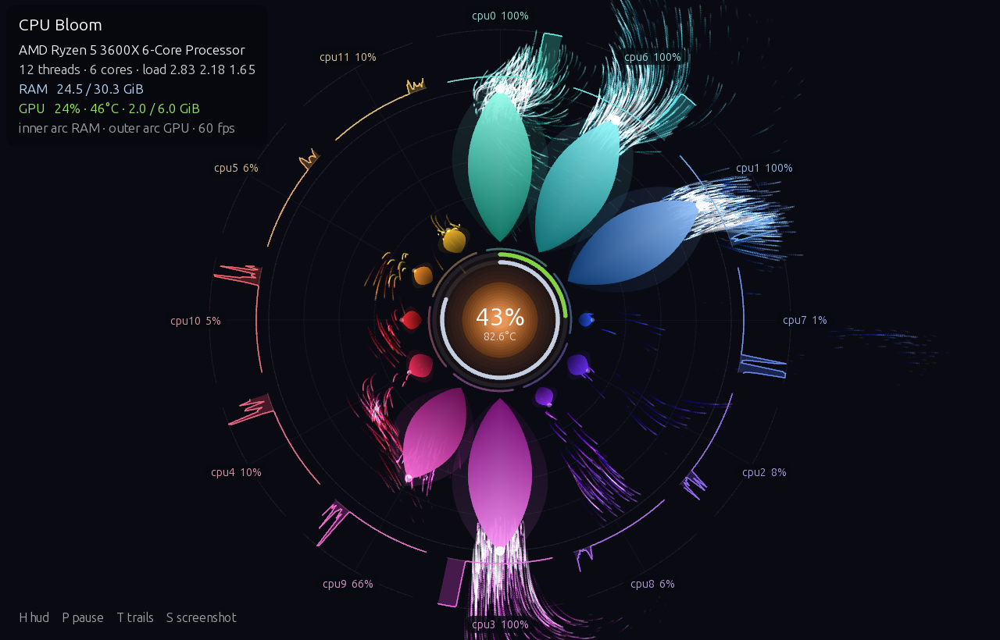
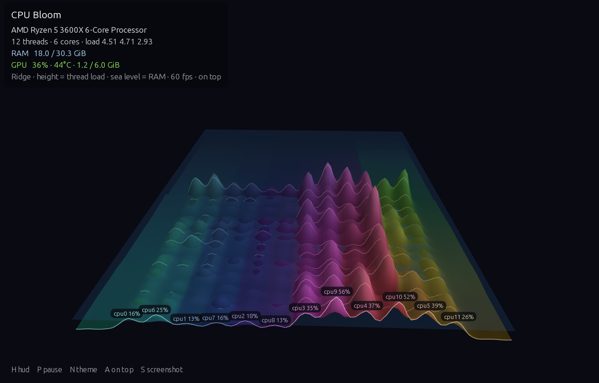
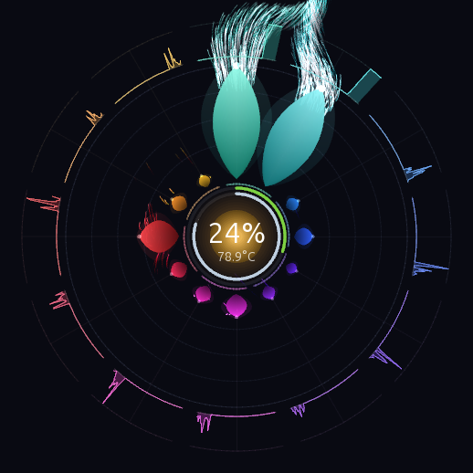

# CPU Bloom

A live system monitor for Linux and Windows, written in [Processing](https://processing.org), that draws your CPU as a glowing flower. Other looks are available as themes, and you can write your own in Processing.

[](https://snapcraft.io/cpu-bloom)



## Themes

| Theme | Look |
| --- | --- |
| **Bloom** (default) | The flower described below. |
| **Ridge** | A 3D landscape with one mountain ridge per thread. The front edge is live, and the last ~15 s scroll back into the fog. A translucent sea rises with RAM use. |
| **Poppy** | A photorealistic poppy that opens with average CPU load. At idle it is a closed bud; at 100% it is in full bloom and has turned to face you. The backlight brightens as the CPU warms up. Its frames are pre-rendered in Blender (see [THEMES.md](THEMES.md#pre-rendered-themes)). |
| **Orchid** | A photorealistic moth orchid that opens with average CPU load, like Poppy. At idle it is a closed bud hanging from its stalk; as the load rises it turns towards you and opens, and at 100% it is in full bloom. The backlight follows CPU temperature, so the petals glow as the CPU warms up. Its frames are also pre-rendered in Blender. |




To switch themes, press **N** in the window, pick one from **Theme** in the top-bar menu, or run `cpu-bloom --theme=ridge`. The choice is remembered and also applies to the overlay.

**Make your own:** a theme is one `.pde` file with a class that extends `Theme`. Drop it into `cpu_bloom/` and run `./install.sh`; it appears in the menu automatically. [THEMES.md](THEMES.md) has the API, the available data, and a complete 30-line example.

## Bloom

- **Petals:** there is one petal per CPU thread, and its length follows that thread's load. The two threads of each physical core sit side by side, joined by a short arc under the pair.
- **Particles:** busy petals shed glowing particles that drift through a Perlin-noise flow field. The busier the thread, the more particles it sheds, and the faster and whiter they burn.
- **History ring:** the outer ring is a polar sparkline of each thread's last 45 seconds.
- **Core:** the orb at the centre shows average load and grows with it. Its colour follows CPU temperature, from cyan when cool through amber to red near 90 °C.
- **Arcs:** the inner arc around the core shows RAM in use. The outer arc shows GPU utilisation and only appears when `nvidia-smi` is available.

Ideas borrowed from the [Processing examples](https://processing.org/examples): Simple/Smoke Particle System, Noise 2D/3D, Radial Gradient and Pulses.

## Desktop app

CPU Bloom installs as a regular desktop app. It is developed on GNOME, but it relies only on cross-desktop standards: an X11 window with EWMH hints, a StatusNotifierItem tray icon, and XDG desktop and autostart files. So it should also work on KDE Plasma, Xfce, Cinnamon, MATE, Budgie, LXQt and other Linux desktops. It has these parts:

- **App window:** "CPU Bloom" appears in the app menu (Activities on GNOME), and its window groups under its own icon in the dock or taskbar.
- **Overlay:** a small, borderless view that stays on top of other windows and shows on every workspace. Drag it to move it, scroll to resize it, and press `Esc` to close it. Its position and size are remembered. It ignores other keys, so typing never reaches it by accident if it takes focus when it opens.
- **Tray indicator:** a flower icon with the current average CPU load, in the top bar or system tray. Its menu opens the window or the overlay, closes it, switches the **Theme**, and toggles **Keep Window on Top**, **Start at Login** and **Show Overlay at Login**. It is optional; see [Without a tray](#without-a-tray).
- **Always on top:** the full window can stay above other windows too. Toggle it from the menu or with `A` in the window. The setting is remembered in `~/.config/cpu-bloom/settings.properties` (or under `$XDG_CONFIG_HOME`), and the menu tick and the window stay in sync.



### Requirements

| | Needed |
| --- | --- |
| CPU | x86_64. aarch64 works if you build it yourself with `--arch=aarch64`. |
| Display | An X11 session, or a Wayland session with Xwayland. The window is an X11 window. |
| Graphics | OpenGL 2 or later, through Mesa or your GPU vendor's driver. |
| Java | Nothing: the app bundles its own Java runtime. |
| Tray icon (optional) | `gjs`, the Ayatana AppIndicator library, and a desktop that shows StatusNotifier icons (see below). |
| GPU arc (optional) | `nvidia-smi`, from the NVIDIA driver. |
| Fonts | At least one font installed, or Java's window toolkit won't start. The packages pull in DejaVu. Ubuntu Sans is optional: without it, the UI falls back to Processing's default font. |

Each user has their own settings, so one installation can serve every account on the computer.

### Desktops

| Desktop | Window and overlay | Tray icon |
| --- | --- | --- |
| GNOME | Yes | With the "AppIndicator and KStatusNotifierItem Support" extension (on by default in Ubuntu) |
| KDE Plasma | Yes | Yes |
| Xfce 4.16+ | Yes | Yes |
| Cinnamon, MATE, Budgie, LXQt | Yes | Yes |
| Sway, Hyprland and other wlroots compositors | Needs Xwayland. Always-on-top and show-on-every-workspace depend on the compositor's rules. | In waybar's `tray` module |

**Start at Login** writes a standard XDG autostart file. Desktops that don't read XDG autostart, such as some tiling setups, need `cpu-bloom --background` (or `--overlay`) added to their own startup config instead.

### Without a tray

If `gjs` or the Ayatana library isn't installed, or no tray is running, the launcher still works: it opens the window or overlay without an indicator, and stops when you close it. `--quit` and `--theme=` still work. `--background` does nothing, because there is no indicator to keep running. Set `CPU_BLOOM_NO_TRAY=1` to run this way even when a tray is available.

### Install from the Snap Store

```bash
sudo snap install cpu-bloom
sudo snap connect cpu-bloom:hardware-observe   # CPU temperatures
```

The snap is strictly confined. It needs `hardware-observe` to read the temperature sensors, and snaps don't connect that interface on their own. It can't run the host's `nvidia-smi`, so the snap shows no GPU readout. Its settings, autostart entry and Poppy cache live under `~/snap/cpu-bloom/`, and screenshots still go to `~/Pictures/CPU Bloom`.

### Install from a package

Download a package from the [latest release](https://github.com/dgcarr/cpu-bloom/releases/latest). Release packages install under `/usr` for every account on the computer, and pull in what they need:

```bash
sudo apt install ./cpu-bloom_0.2.0-1_amd64.deb                     # Debian, Ubuntu, Mint, Pop!_OS
sudo dnf install ./cpu-bloom-0.2.0-1.x86_64.rpm                     # Fedora, RHEL (zypper on openSUSE)
sudo pacman -U ./cpu-bloom-0.2.0-1-x86_64.pkg.tar.zst               # Arch, Manjaro, EndeavourOS
```

The tray libraries are only recommended, not required: without them you get the window and overlay but no tray icon. The `.deb` and `.rpm` install them by default. On Arch, install them yourself with `sudo pacman -S gjs libayatana-appindicator`.

On other distributions, unpack the release tarball (`cpu-bloom-0.2.0-linux-x86_64.tar.gz`) and run `./install.sh --no-build`, which installs for your user only. To install for everyone instead, run `sudo ./install.sh --no-build --prefix=/usr/local`.

### Windows 64-bit portable build

The repository includes a ready-to-run [Windows x64 bundle](CPU-Bloom-Windows/),
with the application from the 0.3.4 build, Java runtime, libraries and all four
themes. After cloning or downloading and extracting the repository, open
`CPU-Bloom-Windows` and double-click `cpu_bloom.exe`. Keep the entire folder
together; the EXE alone is not the application. No separate Java installation is
needed. From PowerShell at the repository root:

```powershell
.\CPU-Bloom-Windows\cpu_bloom.exe
# Optional: launch directly into the system tray
.\CPU-Bloom-Windows\cpu_bloom.exe --start-minimized
```

This bundle was tested on Windows 11 x64 and requires an OpenGL-capable graphics
driver. It is unsigned; it is not a Microsoft Store release and these instructions
do not require disabling Windows security protections.

Run `packaging/build-windows.sh` on Linux with Processing 4, Python 3 and
`gcc-mingw-w64-x86-64-posix` installed. It creates
`dist/cpu-bloom-windows-x64.zip` with a native x64 launcher and a checksum-verified
Windows x64 Java runtime. Extract the entire ZIP and run `cpu_bloom.exe`.

Windows CPU load, core grouping and RAM readings use OSHI. The theme keys and
`--overlay` option work through the same application code. CPU temperature,
and Unix load average are unavailable. The normal window has a top-right Menu
for themes, Preferences and minimizing to the Windows system tray. Drag the
bottom-right grip to resize; the size is remembered. Double-click the tray icon
to restore, or right-click for its menu. Preferences includes an optional
**Start with Windows** checkbox (off by default), which manages a shortcut in
your personal Startup folder. Retick it after moving the portable folder.
Settings are stored under `%APPDATA%\CPU Bloom`. The Windows build is unsigned.

When minimized or hidden in the tray, rendering and animation decoding pause,
GPU polling stops, and CPU/RAM/temperature sampling slows to once every two seconds.
Restoring the window wakes sampling immediately. Windows minimize detection also
works without a tray icon. The window and graphics caches remain in memory for
quick restoration; a visible window still renders even if another window covers it.
Rendering supports compatible AMD/Intel/NVIDIA OpenGL drivers. The optional GPU
metrics use a vendor-independent Windows GPU activity provider; see
[Windows GPU counter implementation](packaging/msix/GPU-INVESTIGATION.md) for its
scope and validation. It reports utilization, with temperature and memory omitted
when unavailable.

### Microsoft Store / MSIX

[Privacy policy](https://dgcarr.github.io/cpu-bloom/privacy.html) ·
[Support](https://dgcarr.github.io/cpu-bloom/support.html)

The Windows 11 x64 MSIX build is described in
[`packaging/msix/README.md`](packaging/msix/README.md). It bundles Java, declares
an opt-in Windows startup task, isolates settings/cache by package identity, and
supports restoring an existing tray instance on a second launch. Portable
preferences can be exported/imported explicitly without copying startup consent.
Local test packages are clearly marked and are not Store submissions. Store
release builds require your assigned Partner Center identity, published privacy
and support URLs, and completed rights/license review.
The 0.3.2 local package completed WACK with an overall **WARNING**, including an
optional blocked-executables test failure and a DPI-awareness warning; see the
[validation record](packaging/msix/VALIDATION.md). Generated MSIX files and build
logs remain under ignored `dist/`; the committed runnable bundle above is portable.

### Install from source

You need Processing 4 (tested with 4.5.7) in `/opt/processing` or at `$PROCESSING`.

```bash
./install.sh
```

This exports a standalone build with its own Java runtime into `out/`, then installs it for your user only:

| Path | Contents |
| --- | --- |
| `~/.local/lib/cpu-bloom/` | the exported app and the indicator |
| `~/.local/bin/cpu-bloom` | the launcher |
| `~/.local/share/applications/cpu-bloom.desktop` | the app menu entry |
| `~/.local/share/icons/hicolor/scalable/apps/` | the app icon and tray icon |

| Option | Effect |
| --- | --- |
| `--no-build` | Reinstall the existing `out/` build without running Processing. |
| `--prefix=DIR` | Install under `DIR` instead of `~/.local`, for example `/usr/local` for every account. |
| `--destdir=DIR` | Stage the files under `DIR` for packaging. |
| `--variant=linux-aarch64` | Build for 64-bit ARM. |
| `--uninstall` | Remove everything that was installed under the prefix. |

To install for every account, build as yourself and then install as root, so Processing doesn't run as root:

```bash
./scripts/build-export.sh && pkexec "$PWD/install.sh" --no-build --prefix=/usr/local
```

Turning on **Start at Login** writes `~/.config/autostart/cpu-bloom.desktop` for that user.

```bash
cpu-bloom              # open the full window (and the tray indicator)
cpu-bloom --overlay    # open the always-on-top overlay
cpu-bloom --background # indicator only
cpu-bloom --quit       # close everything
cpu-bloom --theme=ridge  # switch theme (remembered); combine with any of the above
```

### Building packages

```bash
packaging/build.sh                 # .deb, .rpm, Arch package and tarball in dist/
packaging/build.sh --arch=aarch64  # the same for 64-bit ARM
```

The script runs `install.sh --prefix=/usr --destdir=dist/root` and then packages the result with [nfpm](https://nfpm.goreleaser.com). It uses nfpm from your `PATH`, or else nfpm's Docker image. Its dependency lists are in [packaging/nfpm.yaml](packaging/nfpm.yaml). Only the build machine needs Processing and nfpm. The version comes from the latest git tag (`v0.2.0` → `0.2.0`), or from `--version=`.

To build the snap, export first, because Processing runs only on the host and not in snapcraft's build container. [snap/snapcraft.yaml](snap/snapcraft.yaml) then packs the `out/` export:

```bash
scripts/build-export.sh && snapcraft pack
snapcraft upload --release=stable cpu-bloom_0.2.0_amd64.snap   # after snapcraft login
```

## Running from source

```bash
/opt/processing/bin/Processing cli --sketch=cpu_bloom --run
```

You can also open `cpu_bloom/cpu_bloom.pde` in the Processing editor and press Run.

| Key | Action |
| --- | --- |
| `H` | Toggle the HUD |
| `P` / `Space` | Pause |
| `N` | Next theme |
| `A` | Toggle always on top (full window) |
| `T` | Toggle particle trails (Bloom) |
| `S` | Save a screenshot to `~/Pictures/CPU Bloom/` |

To save a single frame after 8 seconds and quit, which is handy for checks without a person watching:

```bash
CPU_BLOOM_SNAPSHOT=/tmp/bloom.png /opt/processing/bin/Processing cli --sketch=cpu_bloom --run
```

## Where the numbers come from

All sampling runs on a background thread, so it never stalls rendering.

| Metric | Source | Interval |
| --- | --- | --- |
| Per-thread load | `/proc/stat` | 200 ms |
| Thread pairing | `/sys/devices/system/cpu/cpu*/topology` | once |
| RAM | `/proc/meminfo` (`MemTotal − MemAvailable`) | 500 ms |
| Load average | `/proc/loadavg` | 1 s |
| CPU temperature | `/sys/class/hwmon`, `k10temp` / `zenpower` / `coretemp` | 1 s |
| GPU | `nvidia-smi --query-gpu=…` | 2 s |

## Troubleshooting

**The sketch hangs with `UnsatisfiedLinkError … JVMUtil.initialize`.**
The Processing 4.5.7 `.deb` installs the bundled JDK's `jspawnhelper` without execute permission. Java then cannot start any other program, including the check the OpenGL library (JOGL) runs at startup and the `nvidia-smi` call. To fix it:

```bash
pkexec chmod 755 /opt/processing/lib/app/resources/jdk/lib/jspawnhelper
```

A Processing package upgrade may undo this fix.

`install.sh` sets the same permission on the copy inside the export.

**Fonts look different.** The UI uses Ubuntu Sans and falls back to Processing's default font if Ubuntu Sans isn't installed.

**The window shows a generic icon in the dock.** The window runs under Xwayland, and the desktop matches it to `cpu-bloom.desktop` through `WM_CLASS=cpu-bloom`. JOGL doesn't set that property, so `WindowClass.pde` sets it through Xlib, using the bundled `code/jna-5.19.1.jar`. Check it with `xprop WM_CLASS` and click the window.

**No tray icon.** Check three things:

- **The libraries:** `gjs` and the Ayatana AppIndicator library are installed. The package is `gir1.2-ayatanaappindicator3-0.1` on Debian and Ubuntu, `libayatana-appindicator-gtk3` on Fedora, and `libayatana-appindicator` on Arch.
- **A tray that shows StatusNotifier icons:** GNOME needs an AppIndicator extension. Ubuntu enables `ubuntu-appindicators@ubuntu.com` by default; on other distributions, install "AppIndicator and KStatusNotifierItem Support". Older Xfce panels need `xfce4-statusnotifier-plugin`. Sway and Hyprland need a bar with a tray, such as waybar.
- **The tray was already running:** the app looks for a tray when it starts. If the tray started later, run `cpu-bloom --quit` and start CPU Bloom again.

**The window doesn't open on Wayland.** It needs Xwayland. GNOME and KDE start it automatically; on Sway or Hyprland, check that Xwayland is enabled.

## Layout

```
cpu_bloom/
  cpu_bloom.pde      host: settings/setup/draw, HUD, fonts, keys, arguments
  Theme.pde          the Theme base class and threadHue() (see THEMES.md)
  Themes.pde         theme discovery by reflection, switching, --list-themes
  BloomTheme.pde     the Bloom theme: trail layer + Bloom + ParticleField
  Bloom.pde          petals, history ring, core orb, RAM/GPU arcs, labels
  ParticleField.pde  particle pool and noise flow field
  RidgeTheme.pde     the Ridge theme: 3D landscape in an offscreen P3D buffer
  FrameSequenceTheme.pde  base for pre-rendered themes: scrubs frames by CPU load and temperature
  FrameCache.pde     on-disk cache of resized frames for FrameSequenceTheme
  PoppyTheme.pde     the Poppy theme (a FrameSequenceTheme)
  OrchidTheme.pde    the Orchid theme (a FrameSequenceTheme)
  data/poppy/        the Poppy frames, dim/ and bright/, rendered in Blender
  data/orchid/       the Orchid frames, dim/ and bright/, rendered in Blender
  SystemSampler.pde  /proc, /sys and nvidia-smi sampling thread
  Overlay.pde        --overlay mode: borderless, always on top, drag/scroll
  Settings.pde       settings.properties shared with the indicator (on top, theme)
  WindowClass.pde    sets X11 WM_CLASS so the desktop matches the .desktop file
  code/jna-*.jar     JNA (Apache-2.0), used by WindowClass.pde
bin/cpu-bloom        launcher: runs tray.js with gjs, or the window directly without it
tray/tray.js         tray indicator and window control (gjs, optional AyatanaAppIndicator3)
icons/               app icon and symbolic tray icon
scripts/build-export.sh  Processing export, patched and trimmed for installing
install.sh           install / uninstall under a prefix (default ~/.local)
packaging/           nfpm config and build.sh for .deb, .rpm, Arch and tarball releases
snap/                snapcraft.yaml and desktop entry for the Snap Store package
```

## Resource use

Closing the window leaves only the tray indicator, which reads CPU counters
once every two seconds. No Java renderer runs in tray-only mode.

Minimizing the window now suspends the JOGL animator, Poppy decoding and GPU
sampling. Restoring it resumes automatically. Pause also stops continuous
rendering; input, resize and theme changes can request a fresh frame. The
visible frame-rate target, antialiasing, image sizes and animation detail are
unchanged. Focus does not control rendering: an unfocused window may still be
visible. On window managers exposing EWMH desktop properties, windows on other
workspaces are suspended too. Full occlusion and screen-lock detection are not
implemented; unsupported visibility information leaves rendering enabled.

Poppy protects its prefetched frames from eviction, so workers do not repeatedly
decode the same images at a steady load. Its optional lossless pixel cache under
`$XDG_CACHE_HOME/cpu-bloom/` (normally `~/.cache/cpu-bloom/`) reuses the exact
Processing-resized pixels. It is capped at 256 MiB, can be deleted safely, and
falls back to the original JPEGs if unavailable. The decoded memory cache targets
24 images and 150 MiB of pixel data; decoder temporaries, GPU textures and the
rest of the application use additional memory.

GPU readings use one persistent `nvidia-smi` process while animating, rather
than a new process per reading. A separate reader and six-second timeout keep
GPU-driver stalls from blocking CPU and memory sampling.

For visibility diagnostics, set `CPU_BLOOM_METRICS=/absolute/path/metrics.csv`.
The optional CSV records cumulative drawn frames and visibility/pause/suspension
state once per second. A suspended window's frame count should remain constant.

## License

CPU Bloom is released under the [MIT License](LICENSE).

The builds also include third-party software under its own licenses:

- [Processing](https://processing.org) core: LGPL-2.1
- [JOGL and GlueGen](https://jogamp.org): BSD-style licenses
- [JNA](https://github.com/java-native-access/jna) (`cpu_bloom/code/`): Apache-2.0 or LGPL-2.1
- The Eclipse Temurin Java runtime that Processing bundles into exports: GPL-2.0 with the Classpath Exception. Its notices are in `java/legal/` inside the export.
